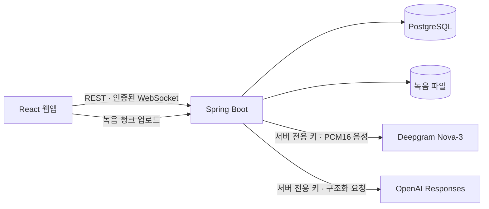

# AI Meeting

집 PC에서 운영하는 개인용 한국어 회의록 웹앱이다. 회의를 녹음하고, 전문용어를 검토하며, 발언을 근거로 회의 내용을 정리한다.

앱은 `MOCK`, `LOCAL_RECORDING`, `LIVE` 모드를 제공한다. `LIVE`는 같은 마이크 입력을 원본 녹음과 Deepgram Nova-3 실시간 전사에 나누고, 회의 종료 후 OpenAI `gpt-6.1-sol` 교정·요약과 주제별 용어 후보를 사용자가 요청할 수 있다. 실제 공급자 품질과 청구액은 사용자가 같은 웹앱에서 확인한다.

## 주요 기능

| 영역 | 현재 동작 |
|---|---|
| 소유자 로그인 | 최초 토큰 확인으로 계정 등록, 이후 아이디·비밀번호 로그인, 선택적 30일 로그인 유지 |
| 회의 관리 | 생성·조회·제목 수정·검색·삭제, Markdown·JSON 내보내기 |
| 마이크 녹음 | 장치 선택, 브라우저 청크 보관, 실패한 업로드 복구, 재생·다운로드 |
| 용어 사전·검토 | 주제별 용어·별칭 승인, OpenAI 후보·교정 제안 검토, 원문과 수정 이력 보존 |
| 요약 | 근거 발언을 참조하는 버전형 Mock/OpenAI 요약, 긴 전사 분할 처리 |
| 비용·보관 | 공급자 요청 전 비용 예약, 월·회의 누적 상한, 사용량 조회, 삭제 후 비용 보존, DB·녹음 백업/복원 |

실제 AI 연결 코드는 구현했지만 한국어 인식률·화자 구분·지연·실청구액과 최신 운영 이미지 배포는 아직 확인하지 않았다. 자동 테스트는 가짜 공급자만 사용하며 비용이 발생하지 않는다. 자세한 상태는 [개발 계획](docs/08-IMPLEMENTATION-PLAN.md), 증거와 한계는 [테스트·검증](docs/07-TEST-AND-EVAL.md)에 둔다.

## 구조와 설계



- **녹음과 전사를 분리한다.** 외부 AI가 중단돼도 로컬 녹음과 업로드 복구 경로를 유지한다.
- **원본을 보존한다.** 최초 확정 전사는 수정하지 않고 교정과 사용자 편집을 revision으로 남긴다.
- **근거를 확인한다.** 요약은 발언 ID를 참조하고, 숫자·LOT·날짜·담당자를 근거 없이 바꾸지 않는다.
- **개인 운영에 맞춘다.** 단일 소유자·동시 회의 1개, PostgreSQL과 파일 저장을 사용한다. SaaS·결제·조직 계정·로컬 AI 운영은 범위 밖이다.

| 계층 | 기술 |
|---|---|
| 웹 | React 18, TypeScript, Vite, Tailwind CSS |
| 서버 | Java 21, Spring Boot 3.5, REST, WebSocket |
| 저장 | PostgreSQL 17, Flyway, 로컬 녹음 파일 |
| 운영 | Docker Compose, Tailscale Serve의 비공개 HTTPS |
| 테스트 | JUnit, H2·실제 PostgreSQL, Vitest, Playwright, Python unittest |

경계와 처리 흐름은 [아키텍처](docs/03-ARCHITECTURE.md), 선택 이유와 변경은 [기술 결정](docs/10-DECISIONS.md)에 설명한다.

## 실행

Docker Desktop의 Linux 엔진과 Compose가 필요하다. 저장소 루트에서 실행한다.

```powershell
if (-not (Test-Path -LiteralPath .env)) { Copy-Item .env.example .env }
# 최초 설정: .env의 APP_OWNER_TOKEN(무작위 32자 이상), POSTGRES_PASSWORD 변경
docker compose up -d --build
```

이미 `.env`가 있으면 복사 단계를 생략한다. `http://localhost:8088`에서 최초 한 번 `APP_OWNER_TOKEN`으로 소유자를 확인하고 계정을 등록한다. 이후에는 아이디·비밀번호를 사용한다. Mock 회의는 합성 전사를, 마이크 녹음 회의는 실제 녹음 저장을 확인하는 용도다.

기본 실행은 공급자 호출을 끈다. 비공개 배포에서 실제 AI를 사용할 때는 Windows 사용자 또는 현재 프로세스에 두 공급자 키를 등록하고 다음 스크립트를 실행한다. 키를 `.env`에 기록하거나 출력하지 않으며, `-EnablePaidAi`가 없으면 유료 호출을 강제로 끈다.

```powershell
powershell.exe -NoProfile -ExecutionPolicy Bypass -File .\scripts\start-private.ps1 -EnablePaidAi
```

앱의 월 예산 기본값은 `0 USD`이므로 로그인 후 **사용량·예산**에서 양수로 저장해야 새 요청이 시작된다. 처음에는 `3 USD`처럼 작은 값으로 두고 확인한다. 기본 시간 상한은 회의당 최대 4시간이며, 회의당 금액은 사용량·예산에서 설정한다(초기값 3 USD). 비용은 설정 단가를 사용한 사전 예약·추정치다. 공급자의 최종 청구액을 보장하지 않는다.

종료는 `docker compose down`이다. `down -v`는 DB·녹음 볼륨을 삭제한다. 웹은 기본 `127.0.0.1:8088`에만 바인딩하고 API·DB는 내부 네트워크에서 사용한다. 다른 기기에서는 양쪽 Tailscale에 로그인한 뒤 HTTPS 주소로 접속한다. 설정과 PC 재시작 후 운영 방법은 [보안·운영](docs/13-SECURITY-OPS.md#vpnhttps-배포-게이트)을 따른다.

## 로컬 개발과 테스트

JDK 21, Node.js 22.12 이상(또는 20.19 이상), PostgreSQL이 필요하다.

```powershell
cd apps/api
$env:APP_OWNER_TOKEN='<무작위 32자 이상의 로컬 토큰>'
$env:DATABASE_URL='jdbc:postgresql://localhost:5432/ai_meeting'
$env:DATABASE_USER='ai_meeting'
$env:DATABASE_PASSWORD='<로컬 DB 비밀번호>'
.\mvnw.cmd spring-boot:run
```

별도 터미널에서 `apps/web`으로 이동해 `npm ci`, `npm run dev`를 실행한다. 웹은 `http://localhost:5173`, API health는 `http://localhost:8080/actuator/health`다. Vite가 API와 WebSocket을 중계한다. 포트를 바꾸면 웹의 `API_PROXY_TARGET`과 서버의 `APP_ALLOWED_ORIGINS`를 함께 설정한다.

기본 검증은 `apps/api`의 `.\mvnw.cmd test`, `apps/web`의 `npm test`, `npm run lint`, `npm run build`다. Bash에서는 `./mvnw`를 사용한다. 실제 PostgreSQL·브라우저·운영 검증의 조건과 명령은 [테스트 안내](docs/07-TEST-AND-EVAL.md#테스트-실행)에 모았다. 기본 테스트는 유료 API를 호출하지 않는다.

## 문서

| 목적 | 문서 |
|---|---|
| 제품과 설계 이해 | [요구사항](docs/01-PRD.md) · [사용자 흐름](docs/02-USER-FLOW.md) · [아키텍처](docs/03-ARCHITECTURE.md) |
| 구현 상세 | [데이터 모델](docs/04-DATA-MODEL.md) · [API 계약](docs/05-API-CONTRACT.md) · [AI 파이프라인](docs/06-AI-PIPELINE.md) |
| 현재 상태 확인 | [테스트·검증](docs/07-TEST-AND-EVAL.md) · [개발 계획](docs/08-IMPLEMENTATION-PLAN.md) |
| 비용과 운영 | [비용 정책](docs/09-COST.md) · [기술 결정](docs/10-DECISIONS.md) · [보안·운영](docs/13-SECURITY-OPS.md) |

[문서 전체 안내](docs/README.md) · [운영 스크립트](scripts/README.md) · [브라우저 테스트](tests/e2e/README.md) · [개발 지침](AGENTS.md)

### 연결 복구와 이어 녹음

AI 연결 오류는 녹음 저장과 별개다. 월 예산 등을 수정한 뒤 녹음 화면의 **AI 전사 다시 연결**을 누르면 새 음성부터 전사한다. 새로고침으로 중단된 미종료 회의는 같은 브라우저에서 **청크 복구 후 녹음 재개**로 이어간다. 중단된 동안의 음성은 복구되지 않는다. 월 예산과 회의당 최대 예산은 **사용량·예산**에서 각각 저장한다. 이어 녹음의 최종 WebM 병합에는 FFmpeg가 필요하며 Docker 이미지에 포함된다.
