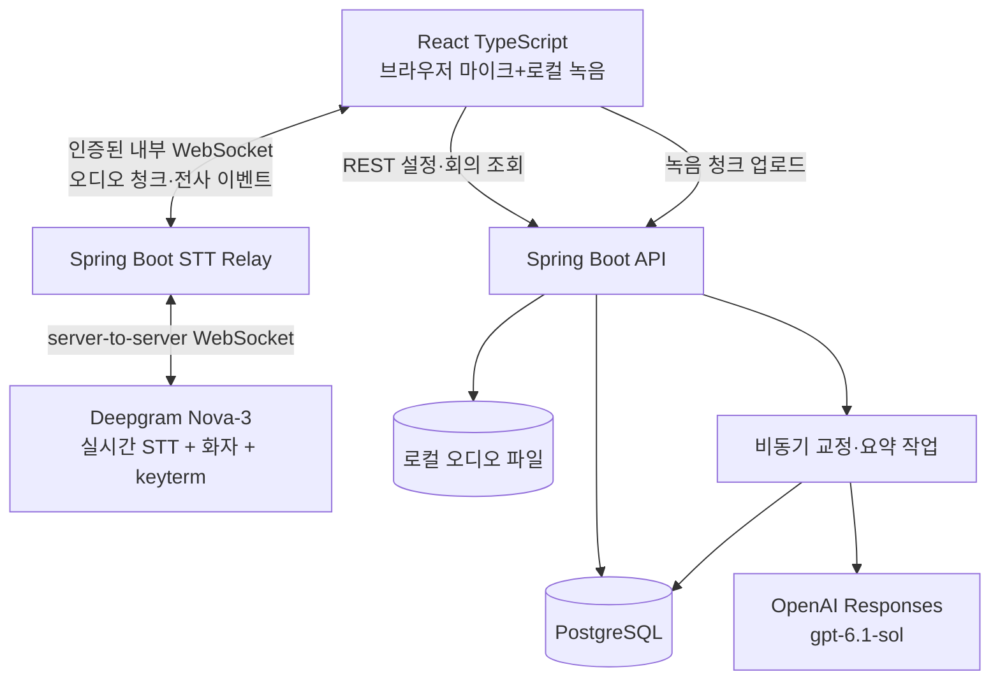

# 03. 시스템 아키텍처 (개인용 v2)

아래는 목표 구조다. 현재 외부 STT/LLM은 앱에 연결하지 않았으며 구현 상태는 [개발 계획](08-IMPLEMENTATION-PLAN.md)을 따른다.

## 결론
**React SPA + Spring Boot 모듈러 모놀리식 + PostgreSQL + 디스크 + Deepgram(STT 후보) + OpenAI Sol(요약·교정)**. 로컬 Python/STT/LLM Worker **없음**. 공급자 의존성은 `SpeechProvider` 인터페이스로 격리하되 복잡한 자동 AI Router는 만들지 않는다.

## 경계·역할
- **브라우저:** `getUserMedia`, 필요시 AudioWorklet/PCM 변환, 녹음(녹음 형식은 사전 검증), 부분 자막 UI. 직접 Deepgram/OpenAI 장기 키 접근 금지.
- **Spring Boot:** 회의 상태/인증/저장소/비동기 작업/비용 기록, 오디오 WebSocket relay. 실시간 스트림에 DB 또는 LLM이 블로킹 영향을 주지 않도록 메모리 큐·별도 실행자/백프레셔 설정.
- **Deepgram:** 첫 후보 `model=nova-3&language=ko&interim_results=true&diarize_model=latest&keyterm=...`. 실제 endpoint/파라미터 계약은 구현 당시 문서에 따라 검증. `diarize_model=v2`는 **스트리밍 불가**.
- **OpenAI:** 요약·교정·용어 후보에만 사용. `gpt-6.1-sol` Standard / Responses / 구조화 출력.
- **DB:** 메타데이터, 확정 발언, 화자, 교정 버전, 요약, 사용량.
- **디스크:** 녹음 청크·합쳐진 녹음, SHA-256, 보관 기간 설정. 외부 공개 금지.

## Streaming 핵심 흐름
1. 시작 전 인증·예산·마이크·주제 용어 검증.
2. 서버가 Deepgram WebSocket 오픈. 브라우저와 서버 사이 인증된 별도 WebSocket으로 오디오 프레임 전송.
3. 브라우저 녹음은 STT 송신 실패와 **무관하게 지속**. 일정 크기·시간으로 나눠 서버 업로드; 전송 실패 시 재시도 가능하게 임시 저장 방안 검증.
4. Deepgram 단어/문장 interim & final, speaker ID, timestamp를 **공급자별 adapter**가 내부 이벤트로 변환.
5. UI는 interim 즉시 표시. final만 장기 DB 저장(이벤트 중복 방지 키 및 offset).
6. 문장 확정 후 안전한 사전 검사 → 선택적 Sol 교정. 사용자 고정 문장은 AI가 변경 불가.
7. 종료 시 오디오 청크 finalize, 전사와 시간축 정합성 검사, 요약·결정/할 일 작성. 불확실한 구간을 사용자 검토 큐로.

## 처리 시간/운영 한계
- P95 첫 자막 3초 이내 목표: 원격 STT 결과+WebSocket roundtrip+UX를 **집에서 측정**해야 함. 선언만으로 보장 불가.
- 동시 접속은 **사용자 1명·회의 1개**. 연결 수/월 예산과 분당 API 비용을 제한.
- 3~4시간 회의에서 provider WebSocket 또는 집 인터넷 끊길 수 있음; 회의 내 `streamSessionId`와 `audioOffsetMs`로 재연결·시간 매핑.
- 장시간 녹음 포맷/코덱과 timestamp 드리프트는 별도 검증 필요.
- PC 오디오(Teams/Zoom) 캡처는 브라우저/OS 권한 제약으로 **MVP 범위 밖**, 대면 마이크부터.

## 추후 확장시 고려, 지금은 배제
Redis, Kafka, K8s, 벡터 DB, 로컬 pyannote, GPU 서버, WebRTC 별도 SFU, 테넌트·결제 시스템. 공급자 변경이 실제 필요할 때만 second adapter 추가.
