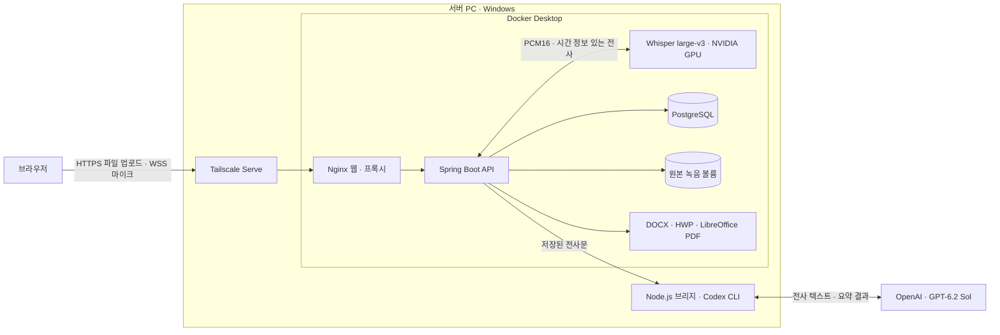

# 03. 시스템 아키텍처

기본 운영에서 웹·API·PostgreSQL·Whisper는 Windows Docker Desktop에서 실행한다. Whisper large-v3는 RTX 3060 Ti의 GPU를 사용해 음성을 전사한다. 요약·교정·용어 후보는 Windows 호스트의 Codex CLI가 OpenAI에 요청한다. [사용 순서](02-USER-FLOW.md) · [검증 결과](07-TEST-AND-EVAL.md)

## 구성과 데이터 흐름

- **마이크**는 MediaRecorder로 원본 녹음 청크를 보관하고, AudioWorklet으로 만든 PCM16 mono 16 kHz를 인증된 WebSocket으로 보낸다. API는 약 8초 단위로 Whisper에 전달하고, 종료 시 남은 음성도 처리한다. 녹음 청크 업로드는 전사 연결과 독립적으로 진행한다.
- **파일 업로드**는 원본과 작업 상태를 저장한다. API가 FFmpeg로 변환한 PCM을 Whisper에 보내면, Whisper가 최대 30초씩 처리해 한국어 전사와 시각을 돌려준다. API가 전사를 저장하고 요약을 요청한다. 요약 실패 시 저장된 전사부터 이어서 실행한다.
- **요약**은 API가 Windows 브리지에 전사 텍스트를 전달한다. 브리지는 ChatGPT 로그인으로 `codex exec`를 실행하며 API가 결과와 근거 발언 ID를 검증해 저장한다. 마이크 회의는 종료 후 버튼으로 요청하고, 파일 업로드는 전사 저장 후 자동으로 요청한다.
- **내보내기**는 저장된 전사와 요약을 같은 스냅샷으로 읽는다. DOCX와 HWP를 생성하고, PDF는 DOCX를 LibreOffice로 변환한다.

Whisper에는 자동 화자 분리가 없어 새 발언의 화자는 미정으로 기록한다. 구간별 자막 지연과 장시간 처리 품질은 실제 회의에서 검증할 항목이다. 한 번에 마이크 회의 하나를 운영하며, 기본 경로에는 회의당 전사 시간과 Codex 구독 한도가 적용된다.

## 기존 Deepgram 진단 모드의 소유권 보호
선택적인 `DeepgramStartupRecovery`는 전용 PostgreSQL 세션의 advisory lock을 감시하고 예약·전송·연결 직전에 소유권을 재확인한다. 잠금·연결·backend PID가 바뀌면 해당 인스턴스의 guarded STT만 재시작 전까지 차단한다. 활성 STT는 `OWNERSHIP_LOST`로 종료하고 전송된 비용은 `UNCERTAIN`으로 남긴다. 회의와 로컬 녹음은 계속된다.

감시 주기는 기본 1초, JDBC query/network 제한은 2초/3초다. 유료 모드에서 시작 복구와 소유권 확인을 활성화하고, 소유권 유실은 공급자 연결과 후속 저장을 차단한다. 잠금 유실·재시작 경합 검증 결과는 [07](07-TEST-AND-EVAL.md)에 기록한다. 한국어 품질은 같은 앱의 실사용에서 확인한다.

## 추후 확장시 고려, 지금은 배제
Redis, Kafka, K8s, 벡터 DB, 로컬 pyannote, GPU 서버, WebRTC 별도 SFU, 테넌트·결제 시스템. 공급자 변경이 실제 필요할 때만 second adapter 추가.

## 2026-11-12 · 기존 Deepgram 연결 복구

브라우저가 PCM 프레임을 처리하면서 `stream.ping`을 5초마다 보내고 relay의 `stream.pong` 또는 다른 이벤트가 15초간 없으면 소켓을 교체한다. 서버는 PCM 입력 시각을 단조 시계로 기록하고 2초 주기 감시에서 20초 이상 입력이 없는 전사 연결을 종료한다. TCP 종료 통지가 늦어도 공급자에 CloseStream을 요청해 확정 결과·비용 정산·claim 해제를 수행한다. 보기 연결·회의·원본 녹음은 유지한다.

활성 claim이 남아 있는 동안 새 예약을 만들지 않고 `stream.retry`로 정리 대기를 알린다. 브라우저는 지수 지연(0.5~8초), 연속 최대 12회로 재시도하며 성공하면 횟수를 초기화한다. 공급자 연결 수립은 10초로 제한한다. 실제 예산·시간 부족은 `stream.error`로 중단하고 안전한 코드만 로그에 남긴다. 정산 뒤 새 예약의 길이는 회의 경과 시간, 원장의 누적 전사 시간, 남은 월·회의 예산 중 가장 작은 허용 범위를 사용한다. 미확정 비용·시간은 기존 보수적 예약을 유지한다. DB 스키마 변경은 없다.

## 2026-11-04: 개인 PC Codex 구독 경로 (ADR-023)

요약·교정·용어 후보는 기존 segment/evidence 검증과 DB 저장을 유지하고 생성 전송만 교체한다. 브라우저 → Spring API → `host.docker.internal:8767`의 토큰 인증 bridge → Windows `codex exec` → 검증 → 저장. ChatGPT 로그인은 PC의 Codex 저장소에만 남으며 Docker에 복사하지 않는다. CLI는 도구·검색을 끄고 임시 디렉터리에서 ephemeral/schema 출력으로 실행한다. 동시 작업 1개, 요청별 10분 제한, 결과/스키마 임시 파일 삭제를 적용한다. 별도 API 자동 fallback은 없다. 실패는 로그인·구독 한도·연결·모델·시간초과 코드로 UI에 전달한다.

모델 추론은 OpenAI 서버에서 진행되며 PC는 CLI 실행 호스트다. 구독 한도는 그대로 적용되고 이 경로는 API 달러 원장에 예약/정산하지 않는다. 별도 유료 Deepgram 모드는 서버의 예약·추정 비용과 예산 제한을 사용한다. 이전 비용 기록은 사용자 요청으로 정리했으며 공식 Deepgram 사용량·청구액 조회는 미연동이다. bridge 포트는 웹 프록시나 Tailscale Serve로 공개하지 않는다.

## 2026-11-04: 사용자 화자 수정과 검색 (ADR-025)

`speakers.display_name`은 회의별 표시 이름, `merged_into_label`은 같은 사람으로 연결한 대표 라벨이다. 그룹 연결은 한 단계로 유지하고 그룹 이동·개별 분리를 지원한다. `segment_speaker_overrides`는 발언별 사용자 지정을 저장한다. 공급자 라벨·원문은 변경하지 않으므로 늦은 화자 이벤트가 와도 사용자 지정을 덮어쓰지 않는다. 현재 적용 범위는 화면·근거 표시·회의 내 검색이며 요약 생성 입력과 내보내기는 공급자 라벨을 유지한다.

전체 회의 검색은 DB에서 제목·원문·교정문·표시 이름으로 회의를 찾는다. 회의 내 검색은 로드된 확정 발언과 화면 화자 이름을 브라우저에서 검색하고 발언으로 이동한다. 음성 재분석은 수행하지 않는다.

## 2026-11-04: 기본 기기 간 실시간 보기 (ADR-026)

모든 회의 화면은 `/live?mode=watch`에 자동 연결한다. 이 경로는 동일한 쿠키 인증·Origin 검사·세션 무효화 정책을 적용하지만 음성 공급자·비용 예약·마이크 입력을 시작하지 않는다. 실제 마이크 기기는 기존 `/live?audioOffsetMs=...`를 사용하며 서버가 공급자 이벤트를 같은 회의의 보기 소켓에 전달한다. 조회 창을 닫아도 공급자나 회의를 종료하지 않는다. Mock은 회의별로 한 번만 실행하고 여러 창이 같은 이벤트를 받는다.

보기 전송은 소켓별 128개 대기열과 별도 실행기로 분리한다. 밀린 보기 연결은 닫아 재접속·저장 데이터 조회로 복구한다. 전사 내용은 재접속 시 DB에서 읽으며, 임시 자막은 저장·재생하지 않는다. 화면은 이벤트와 조회가 경합해도 확정 발언을 유지하고 더 낮은 revision으로 되돌리지 않는다. 이름·그룹·발언 화자·수동 교정·회의 상태는 저장 이후 `meeting.changed`로 재조회한다. 15초 주기 및 포커스 복귀 시에도 저장 상태와 요약을 조회하며 AI를 자동 실행하지 않는다. 원격에서 회의를 명시적으로 종료하면 녹음 기기도 원본 청크를 마무리해 저장한다.
