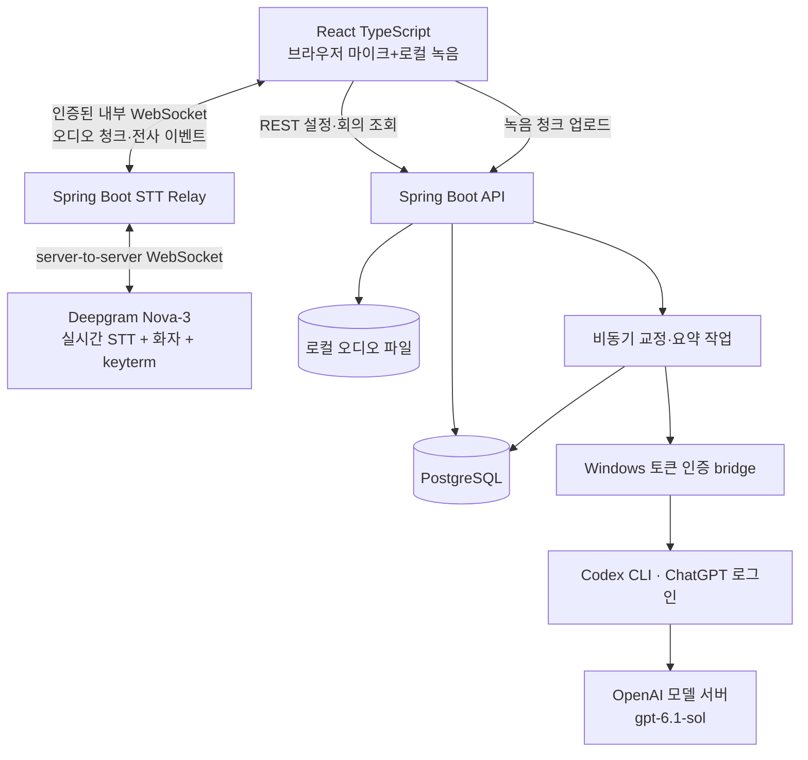

# 03. 시스템 아키텍처

웹앱은 REST로 회의·녹음·사전을 관리하고 Mock 전사 또는 실제 AI를 선택한다. LIVE 모드는 인증된 내부 WebSocket으로 PCM16 16kHz mono 프레임을 서버에 보내고, 서버가 Deepgram으로 전사를 요청한다. 요약·교정·용어 후보는 사용자 요청 시 저장된 텍스트를 Windows 호스트의 Codex bridge에 전달한다. 별도 API 모드를 명시하면 OpenAI Responses API 경로를 선택한다. 구현과 실측 상태는 [개발 계획](08-IMPLEMENTATION-PLAN.md)을 따른다.

## 구조를 선택한 이유
**React SPA + Spring Boot 모듈러 모놀리식 + PostgreSQL + 디스크 + Deepgram Nova-3(실시간 전사) + Windows Codex CLI(요약·교정)**. 웹·API·DB는 Docker Compose에서, Node.js bridge와 CLI는 Windows 호스트에서 실행한다. 모델 추론은 공급자 서버에서 이루어진다. 로컬 Python/STT/LLM Worker는 없으며 공급자 실패 시 다른 유료 API로 자동 전환하지 않는다.

개인 홈서버 한 대에서 운영하므로 배포·백업 단위를 단순하게 유지한다. 관계와 수정 이력은 PostgreSQL에, 큰 오디오 파일은 디스크에 둔다. 브라우저가 공급자에 직접 접속하지 않아 키·예산·회의 시간축을 서버에서 관리할 수 있다.

## 경계·역할
- **브라우저:** 하나의 `getUserMedia` 스트림을 MediaRecorder 원본 녹음과 AudioWorklet PCM16 16kHz mono 전사 송신에 함께 사용한다. 직접 Deepgram/OpenAI 장기 키에 접근하지 않는다.
- **Spring Boot:** 회의 상태/인증/저장소/비동기 작업/비용 기록, 오디오 WebSocket relay. 실시간 스트림에 DB 또는 LLM이 블로킹 영향을 주지 않도록 메모리 큐·별도 실행자/백프레셔 설정.
- **Deepgram:** 첫 후보 `model=nova-3&language=ko&interim_results=true&diarize_model=latest&keyterm=...`. 실제 endpoint/파라미터 계약은 구현 당시 문서에 따라 검증. `diarize_model=v2`는 **스트리밍 불가**.
- **Codex bridge:** 요약·교정·용어 후보에 `gpt-6.1-sol` CLI/schema 출력을 사용. PC의 ChatGPT 로그인을 유지하며 도구·검색은 차단한다. 구독 잔여율은 app-server의 `account/rateLimits/read`로 조회한다. 명시적 API 모드에서만 Responses API를 사용한다.
- **DB:** 메타데이터, 확정 발언, 화자, 교정 버전, 요약, 사용량.
- **디스크:** 녹음 청크·합쳐진 녹음, SHA-256, 보관 기간 설정. 외부 공개 금지.

## Streaming 핵심 흐름
1. 시작 전 인증·예산·마이크·주제 용어 검증.
2. 서버가 Deepgram WebSocket 오픈. 브라우저와 서버 사이 인증된 별도 WebSocket으로 오디오 프레임 전송.
3. 브라우저 녹음은 STT 송신 실패와 **무관하게 지속**. 일정 크기·시간으로 나눠 서버 업로드; 전송 실패 시 재시도 가능하게 임시 저장 방안 검증.
4. Deepgram 단어/문장 interim & final, speaker ID, timestamp를 **공급자별 adapter**가 내부 이벤트로 변환.
5. UI는 interim 즉시 표시. final만 장기 DB 저장(이벤트 중복 방지 키 및 offset).
6. 확정 발언을 저장하고 사용자에게 표시한다. 회의 종료 후 사용자가 교정 후보를 요청하고 검토·적용한다. 자동으로 교정을 요청하거나 적용하지 않는다. 사용자 고정 문장은 AI가 변경 불가.
7. 녹음 종료 시 오디오 청크를 finalize한다. 종료된 회의에서 사용자가 요약 생성을 요청하면 발언을 분할·통합해 버전형 요약을 저장한다. 요약 버튼 동작은 녹음 종료와 별도다.

## 처리 시간/운영 한계
- P95 첫 자막 3초 이내 목표: 원격 STT 결과+WebSocket roundtrip+UX를 **집에서 측정**해야 함. 선언만으로 보장 불가.
- 동시 접속은 **사용자 1명·회의 1개**. 연결 수/월 예산과 분당 API 비용을 제한.
- 3~4시간 회의에서 provider WebSocket 또는 집 인터넷 끊길 수 있음; 회의 내 `streamSessionId`와 `audioOffsetMs`로 재연결·시간 매핑.
- 장시간 녹음 포맷/코덱과 timestamp 드리프트는 별도 검증 필요.
- PC 오디오(Teams/Zoom) 캡처는 브라우저/OS 권한 제약으로 **MVP 범위 밖**, 대면 마이크부터.

## 공급자 소유권 보호
선택적인 `DeepgramStartupRecovery`는 전용 PostgreSQL 세션의 advisory lock을 감시하고 예약·전송·연결 직전에 소유권을 재확인한다. 잠금·연결·backend PID가 바뀌면 해당 인스턴스의 guarded STT만 재시작 전까지 차단한다. 활성 STT는 `OWNERSHIP_LOST`로 종료하고 전송된 비용은 `UNCERTAIN`으로 남긴다. 회의와 로컬 녹음은 계속된다.

감시 주기는 기본 1초, JDBC query/network 제한은 2초/3초다. 유료 모드에서 시작 복구와 소유권 확인을 활성화하고, 소유권 유실은 공급자 연결과 후속 저장을 차단한다. 잠금 유실·재시작 경합 검증 결과는 [07](07-TEST-AND-EVAL.md)에 기록한다. 한국어 품질은 같은 앱의 실사용에서 확인한다.

## 추후 확장시 고려, 지금은 배제
Redis, Kafka, K8s, 벡터 DB, 로컬 pyannote, GPU 서버, WebRTC 별도 SFU, 테넌트·결제 시스템. 공급자 변경이 실제 필요할 때만 second adapter 추가.

## 2026-11-04: 개인 PC Codex 구독 경로 (ADR-023)

요약·교정·용어 후보는 기존 segment/evidence 검증과 DB 저장을 유지하고 생성 전송만 교체한다. 브라우저 → Spring API → `host.docker.internal:8767`의 토큰 인증 bridge → Windows `codex exec` → 검증 → 저장. ChatGPT 로그인은 PC의 Codex 저장소에만 남으며 Docker에 복사하지 않는다. CLI는 도구·검색을 끄고 임시 디렉터리에서 ephemeral/schema 출력으로 실행한다. 동시 작업 1개, 요청별 10분 제한, 결과/스키마 임시 파일 삭제를 적용한다. 별도 API 자동 fallback은 없다. 실패는 로그인·구독 한도·연결·모델·시간초과 코드로 UI에 전달한다.

모델 추론은 OpenAI 서버에서 진행되며 PC는 CLI 실행 호스트다. 구독 한도는 그대로 적용되고 이 경로는 API 달러 원장에 예약/정산하지 않는다. 새 Deepgram 전사는 서버의 예약·추정 비용과 예산 제한을 유지한다. 이전 비용 기록은 사용자 요청으로 정리했으며 공식 Deepgram 사용량·청구액 조회는 미연동이다. bridge 포트는 웹 프록시나 Tailscale Serve로 공개하지 않는다.

## 2026-11-04: 사용자 화자 수정과 검색 (ADR-025)

`speakers.display_name`은 회의별 표시 이름, `merged_into_label`은 같은 사람으로 연결한 대표 라벨이다. 그룹 연결은 한 단계로 유지하고 그룹 이동·개별 분리를 지원한다. `segment_speaker_overrides`는 발언별 사용자 지정을 저장한다. 공급자 라벨·원문은 변경하지 않으므로 늦은 화자 이벤트가 와도 사용자 지정을 덮어쓰지 않는다. 현재 적용 범위는 화면·근거 표시·회의 내 검색이며 요약 생성 입력과 내보내기는 공급자 라벨을 유지한다.

전체 회의 검색은 DB에서 제목·원문·교정문·표시 이름으로 회의를 찾는다. 회의 내 검색은 로드된 확정 발언과 화면 화자 이름을 브라우저에서 검색하고 발언으로 이동한다. 음성 재분석은 수행하지 않는다.

## 2026-11-04: 기본 기기 간 실시간 보기 (ADR-026)

모든 회의 화면은 `/live?mode=watch`에 자동 연결한다. 이 경로는 동일한 쿠키 인증·Origin 검사·세션 무효화 정책을 적용하지만 음성 공급자·비용 예약·마이크 입력을 시작하지 않는다. 실제 마이크 기기는 기존 `/live?audioOffsetMs=...`를 사용하며 서버가 공급자 이벤트를 같은 회의의 보기 소켓에 전달한다. 조회 창을 닫아도 공급자나 회의를 종료하지 않는다. Mock은 회의별로 한 번만 실행하고 여러 창이 같은 이벤트를 받는다.

보기 전송은 소켓별 128개 대기열과 별도 실행기로 분리한다. 밀린 보기 연결은 닫아 재접속·저장 데이터 조회로 복구한다. 전사 내용은 재접속 시 DB에서 읽으며, 임시 자막은 저장·재생하지 않는다. 화면은 이벤트와 조회가 경합해도 확정 발언을 유지하고 더 낮은 revision으로 되돌리지 않는다. 이름·그룹·발언 화자·수동 교정·회의 상태는 저장 이후 `meeting.changed`로 재조회한다. 15초 주기 및 포커스 복귀 시에도 저장 상태와 요약을 조회하며 AI를 자동 실행하지 않는다. 원격에서 회의를 명시적으로 종료하면 녹음 기기도 원본 청크를 마무리해 저장한다.
